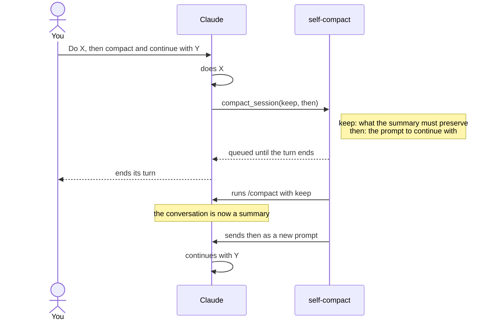

```text
███████╗███████╗██╗     ███████╗       ██████╗ ██████╗ ███╗   ███╗██████╗  █████╗  ██████╗████████╗
██╔════╝██╔════╝██║     ██╔════╝      ██╔════╝██╔═══██╗████╗ ████║██╔══██╗██╔══██╗██╔════╝╚══██╔══╝
███████╗█████╗  ██║     █████╗  █████╗██║     ██║   ██║██╔████╔██║██████╔╝███████║██║        ██║
╚════██║██╔══╝  ██║     ██╔══╝  ╚════╝██║     ██║   ██║██║╚██╔╝██║██╔═══╝ ██╔══██║██║        ██║
███████║███████╗███████╗██║           ╚██████╗╚██████╔╝██║ ╚═╝ ██║██║     ██║  ██║╚██████╗   ██║
╚══════╝╚══════╝╚══════╝╚═╝            ╚═════╝ ╚═════╝ ╚═╝     ╚═╝╚═╝     ╚═╝  ╚═╝ ╚═════╝   ╚═╝
```

[](https://code.claude.com/docs/en/plugins/mods)
[](.claude-plugin/plugin.json)
[](LICENSE)

**A Claude Code mod** that lets Claude compact its own session when you ask it to, then pick the work back up on its own. One request can now say "plan this, compact, then implement".

Out of the box, Claude can't run `/compact`: built-in commands aren't available to the model. self-compact gives it one tool, `compact_session`, and does the rest once the turn ends.

## How it works



1. Claude calls `compact_session` with `keep` (what the summary must preserve) and, optionally, `then` (the prompt to resume with).
2. The mod holds the request until Claude's turn ends. A compaction can't run in the middle of a turn.
3. If the turn ended with an answer, the mod runs `/compact <keep>`, exactly as if you had typed it, then sends `then` as a new prompt.

## Install

At the prompt of a terminal session:

```text
/plugin install self-compact --marketplace 0hte/self-compact
```

Answer `y` to add the marketplace, then pick a scope.

## Use

Ask for it in plain words:

```text
Plan the export feature, write the plan to PLAN.md, then compact your session keeping only what you need and implement it.
```

| Field | Required | What it is |
| --- | --- | --- |
| `keep` | yes | What the summary must preserve: the plan file's path, decisions, constraints, open questions. Passed to `/compact` as its instructions. |
| `then` | no | The prompt Claude receives right after compaction, e.g. `Implement PLAN.md, starting with step 1.` Leave it out to stop after compacting. |

The tool tells Claude to call it only when you asked for a compaction, to write anything that must survive word for word to a file first, and to end its turn right after the call.

## Limits

- Compaction is lossy. It keeps a summary, not the transcript, so a plan or spec belongs in a file that `keep` and `then` name.
- For plan, then implement, plan mode can do this without the mod: set `showClearContextOnPlanAccept` and the plan accept screen gains an option that "approves the plan and clears the planning context". You press it, though, not Claude.
- An interrupted turn (Esc), a refusal or an API error cancels the request. Only the main session can compact itself: a subagent's call is refused.
- The follow-up prompt reaches Claude labeled as sent by the self-compact plugin, not as your words.
- A prompt you type between the end of the turn and the start of the compaction may run first.
- A `PreCompact` hook or another plugin can veto the compaction. The follow-up prompt is still sent, so the work goes on with the context uncompacted.
- If the mod reloads between the tool call and the end of the turn, the request is dropped.

## Develop

Claude Code writes `.claude-plugin/types/` each time it loads the mod, and the folder is gitignored. On a fresh clone, run `claude --plugin-dir .` once before `tsc`.

```bash
claude --plugin-dir .          # load from this folder; saving a file reloads it
claude plugin validate .       # what the engine sees and would refuse
claude plugin test .           # tests/ against the engine's test kit
npx -p typescript tsc -p .     # types
```

## License

[MIT](LICENSE)
